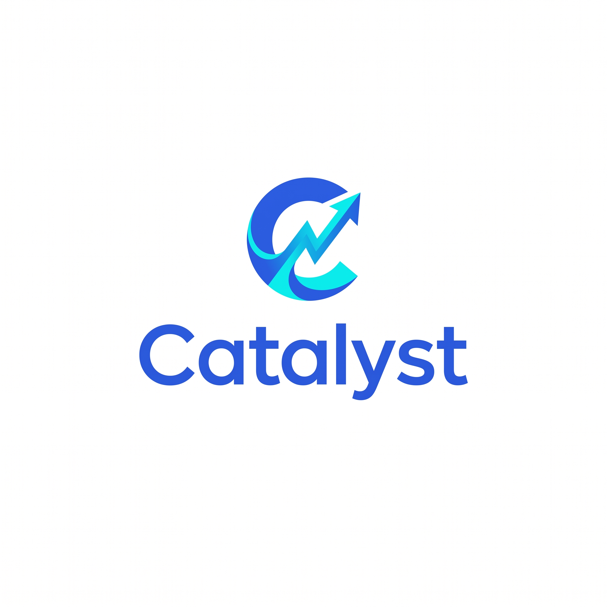
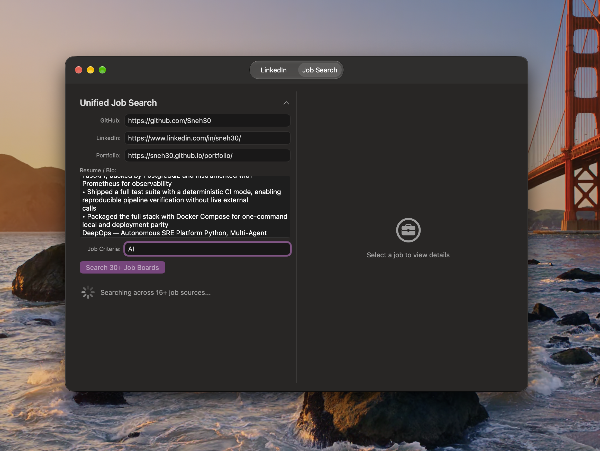

## Explainer video

<video src="https://github.com/Sneh30/Catalyst/raw/HEAD/explainer.mp4" controls preload="metadata" playsinline width="720"></video>

[▶ Watch the explainer video](explainer.mp4)

---

<p align="center">
  
</p>

<h1 align="center">Career OS</h1>

<p align="center">
  Your all-in-one career operating system — jobs, resume, content, and tracking in a single place.
</p>

## Features

- **Job Scanner** — search jobs across 15+ different job portals
- **Resume Auditor** — audit your resume against a target role
- **Resume Generator** — generate tailored resumes
- **Content Studio** — create career-related content
- **Weekly Tracker** — track your job-search progress week by week
- **Auth & Profiles** — register, log in, and manage your profile

## Screenshots

### Searching through 15 different job portals



## Tech Stack

- **Frontend:** React (Vite), React Router, Axios
- **Backend:** FastAPI (Python), SQLite
- **Deployment:** Docker, Procfile

## Download

Grab the latest **Catalyst.app** for macOS from the Releases page:

**[⬇ Download Catalyst.app](https://github.com/Sneh30/Catalyst/releases/latest)**

1. Unzip the downloaded `Catalyst.app.zip`
2. Move `Catalyst.app` to your Applications folder and double-click to open

> **Note:** macOS may warn that the app is from an unidentified developer (it isn't notarized yet). Right-click `Catalyst.app` → **Open** → **Open**, or run:
> ```bash
> xattr -dr com.apple.quarantine /Applications/Catalyst.app
> ```
